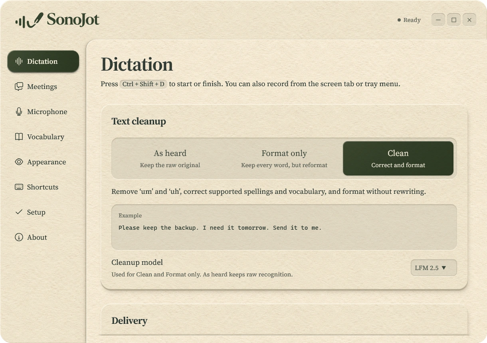

# SonoJot

SonoJot is a local-first dictation and meeting transcription app for Windows and macOS, with an alpha Linux build. Speak into any app, keep the raw recognition, apply conservative cleanup, or transcribe a meeting. Speech models run on your computer. Optional cloud AI features send selected content to the provider you configure; see the [Privacy Notice](https://sonojot.com/privacy).

Get official builds and platform availability at **[sonojot.com](https://sonojot.com)**.



## Build from source

The active desktop app is in `rewrite/`; `web/` contains the website, and `shared/` holds shared presentation code. Models are downloaded separately under their own licenses. No model weights or credentials are included.

Install Git, Node.js 22 LTS with npm, and stable Rust through rustup. Follow the [Tauri 2 prerequisites](https://v2.tauri.app/start/prerequisites/) for your platform:

- Windows: Visual Studio Build Tools with Desktop development with C++, the Windows SDK, and Microsoft Edge WebView2.
- macOS 14 or newer: Xcode Command Line Tools (`xcode-select --install`). Apple Silicon is the primary macOS target. The local Whisper backend builds with Metal.
- Linux (alpha): `webkit2gtk-4.1`, `gtk3`, `libayatana-appindicator`, `librsvg`, `alsa-lib`, `pipewire-alsa` and `wl-clipboard`. On Arch Linux, including Omarchy, `rewrite/scripts/linux/install.sh` installs these with pacman, builds a pacman package from `rewrite/packaging/arch/PKGBUILD` and installs it. The global shortcut and automatic paste need Hyprland; other Wayland desktops get clipboard delivery.

From a terminal:

```sh
git clone https://github.com/Cody-Stevens/sonojot.git
cd sonojot/rewrite
npm ci
npm run tauri dev
```

To build an unsigned local bundle, run `npm run tauri build`. Signing and official release credentials are not needed for development. macOS distribution outside your own machine requires the appropriate signing and notarization setup.

Select and download a model in Setup or Models before recognition. Review its license and hardware requirements before downloading. CUDA and other optional runtimes are separate downloads; CPU support depends on the selected model.

## Checks

```sh
cd rewrite
npm run check
npm test
cd src-tauri
cargo check -j 6
cargo test -j 6 --lib
```

To build the website, run `npm ci` and then `npm run build` in `web/`. Hardware-dependent Rust tests marked ignored require their documented models and runtimes; normal checks do not download weights.

## License and support

SonoJot source is licensed under [Apache-2.0](LICENSE). Third-party code, fonts, downloaded models and runtimes retain their own licenses; see [third-party notices](rewrite/THIRD_PARTY_NOTICES.md). The source license grants no trademark rights. See the [Terms of Use](https://sonojot.com/terms), [Privacy Notice](https://sonojot.com/privacy), and [Trademark Policy](https://sonojot.com/trademarks).

Report bugs and suggest features through [GitHub issues](https://github.com/Cody-Stevens/sonojot/issues), or email support@sonojot.com. Do not attach private recordings, transcripts, or keys. Report vulnerabilities privately as described in [SECURITY.md](SECURITY.md). Read [CONTRIBUTING.md](CONTRIBUTING.md) before sending changes.
